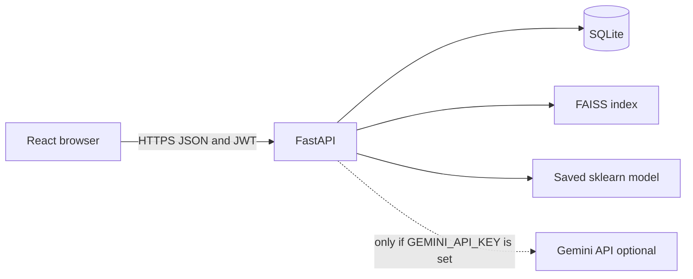
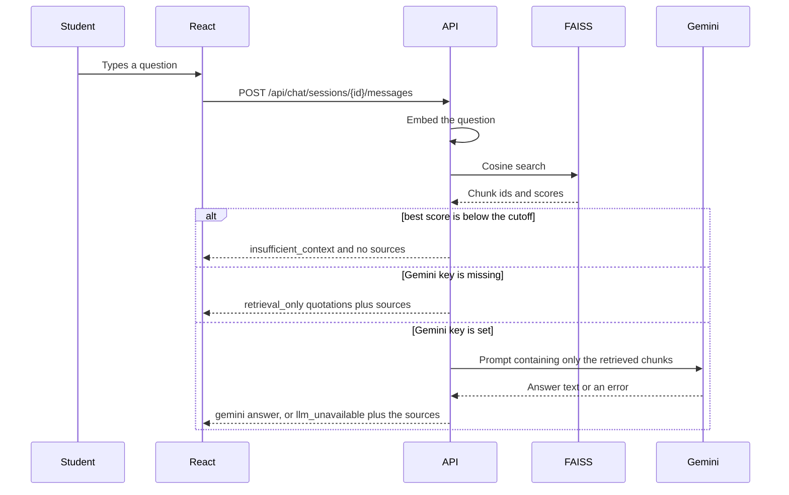

# 2. System architecture

## The four parts

The browser never talks to FAISS, SQLite, or Gemini directly. Every action goes through FastAPI. The token in the browser is a JWT. Each request loads the user from SQLite, so a deactivated account or a changed role applies immediately. The role inside the token is not trusted by itself.

## What happens to a document question

The cutoff in this project is **0.48**. It was chosen by printing real scores with `backend/scripts/probe_scores.py` after the sample PDFs were indexed. A canteen-menu question peaked around 0.39 and is rejected. The attendance question peaked at 0.60 and is kept.

## What happens to a campus action

The workflow assistant does **not** ask Gemini which tool to call. `backend/app/services/agent/intent.py` matches the sentence with explicit patterns. The matching tool is one of five Python functions. Creating a complaint or an event registration waits in the `pending_actions` table until the user replies YES. NO cancels the row and writes nothing else.

This is easier to defend than a framework that lets a model emit arbitrary tool calls. The cost is that unusual wording may be treated as a document search instead of an action.

## Module map

| Folder | Responsibility |
| --- | --- |
| `backend/app/routes` | HTTP, status codes, who is allowed |
| `backend/app/services/rag` | Chunking, embeddings, FAISS, prompts |
| `backend/app/services/agent` | Intent rules, tools, confirmation |
| `backend/app/services/ml` | Training, loading, priority rules |
| `backend/app/models` | SQLAlchemy tables |
| `frontend/src/pages` | Screens |
| `models/deployed.joblib` | The classifier used at prediction time |
| `backend/storage` | SQLite file, PDF uploads, FAISS index |

Routes call services. Services call the database. A route should not contain the embedding math.

## Why these technologies

- **FastAPI** gives request validation and Swagger at `/docs` without a second documentation tool.
- **SQLite** is a single file. It is enough for a viva laptop. Foreign keys are turned on with `PRAGMA foreign_keys=ON` because SQLite leaves them off by default.
- **React + Vite** keeps the interface in components and routes instead of one large page.
- **Sentence Transformers (`all-MiniLM-L6-v2`)** makes a 384-number vector for a sentence on the CPU. No paid embedding API.
- **FAISS `IndexFlatIP`** is an exact scan. On a few hundred chunks that is simpler to explain than an approximate index, and inner product of normalised vectors is cosine similarity.
- **scikit-learn** is the usual library for a TF-IDF baseline and for accuracy, precision, recall, and F1.
- **Gemini** is optional. The code calls `google-genai` only when `LLM_PROVIDER` allows it and `GEMINI_API_KEY` is non-empty. This build was checked with the key empty.

## Decisions you should be able to explain

1. RAG instead of fine-tuning: the rules change when a new PDF is uploaded. Fine-tuning would bake old text into weights and would not cite a page.
2. Store each embedding in SQLite as well as FAISS. Deleting a PDF rebuilds the index from the remaining blobs. The PDF does not have to be embedded again.
3. No priority classifier. We do not have an independently labelled priority set. Predicting labels that we ourselves generated from the same keywords would be circular. The priority function is a keyword list and the screen says so.
4. Tests use a hash embedder (`EMBEDDING_BACKEND=hash`) so the suite does not download the neural model. The demo must stay on `sentence-transformers`. The health endpoint shows which one is active.
