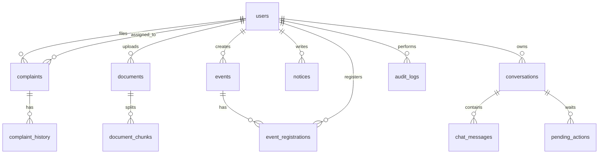

# 3. Database guide

The file is `backend/storage/campuscopilot.db` after you run the app or `scripts/seed.py`. Tables are created by SQLAlchemy in `backend/app/models/entities.py`. There is no Alembic migration. For this project, `Base.metadata.create_all` is enough and is easy to point at in the code.

SQLite does not enforce foreign keys until the connection runs `PRAGMA foreign_keys=ON`. That pragma is in `backend/app/database/session.py`.

## users

| Column | Meaning |
| --- | --- |
| id | Primary key |
| full_name | Display name |
| email | Unique, stored in lower case |
| password_hash | bcrypt hash. Never the password. |
| role | `student`, `faculty`, or `admin`. A check constraint rejects anything else. |
| department | Optional text |
| is_active | False blocks login |
| created_at | UTC timestamp |

Public registration always inserts `student`. An administrator can insert the other roles.

## documents and document_chunks

`documents` stores the title, category, original filename, the random name used on disk, status, page count, and chunk count.

Status values you will see:

- `processed` — text was extracted and indexed
- `needs_ocr` — almost no text. The file is kept so the admin can see the failure. It is not searched. OCR is not implemented.
- `processing` — should only appear for a moment during upload

`document_chunks` stores the page number, the text, and the embedding as a float32 blob. The FAISS file is a search cache. The blobs are the copy used to rebuild that cache.

## complaints and complaint_history

A complaint stores the student's words, an optional category chosen by the student, the model's predicted category and confidence, the rule-based priority, the status, the assignee, and resolution remarks.

Status path: `submitted` → `assigned` → `in_progress` → `resolved` → `closed`. The allowed jumps are in `STATUS_TRANSITIONS` in `backend/app/constants.py`. Resolving or closing requires remarks.

`complaint_history` is append-only. It records who changed the status and the note.

Two foreign keys point at `users`: `user_id` (the author) and `assigned_to`. SQLAlchemy needs `foreign_keys` on the relationship or it cannot tell them apart. That is why `User.complaints` sets `foreign_keys="Complaint.user_id"`.

## events and event_registrations

An event has a start, an end, a venue, and a capacity. `event_registrations` has a unique pair `(event_id, user_id)`. Cancelling sets `status` to `cancelled` instead of deleting the row, so the same student can register again if a seat is free. Capacity counts only rows whose status is `registered`.

## notices

The administrator's audience choice is stored in `audience`. The automatic guess is stored separately in `detected_audience`. `summary_method` is `extractive_fallback` when Gemini is not used. Deadlines and action items are JSON text. Every notice also stores the sentence that these extractions are not verified facts.

## conversations, chat_messages, pending_actions

`conversations.kind` is `rag` or `agent`. Messages belong to the owner of the conversation. Administrators do not get an API to read someone else's chat. Analytics counts question text from document chats only, without the user's name.

`pending_actions.status` is `collecting`, `confirming`, `completed`, or `cancelled`. A complaint row is inserted only when the tool runs, which is after YES.

## audit_logs

Login, failed login (no password is stored), uploads, complaint changes, and event registration write a row. The admin dashboard lists the latest rows.

## Example: a complaint

After the seed script, complaint 1 is Meera Nair's projector report. `user_id` points at her user row. `predicted_category` is Infrastructure. `suggested_priority` is medium because the text matched a disruption keyword. `priority_method` is `rule_based`. A history row says the complaint was created.

## Example: an event registration

The event "DEMO: one-seat tour" has capacity 1. The seed script inserts one `event_registrations` row for `student2@example.com` with status `registered`. A second student receives HTTP 409 if they try to register. The event is demonstration data, not a DAVV event.

## Example: a document

Uploading the attendance PDF creates one `documents` row and several `document_chunks` rows. Each chunk remembers its page. The FAISS index order is the same as the chunk id list in `backend/storage/faiss_meta.json`.
